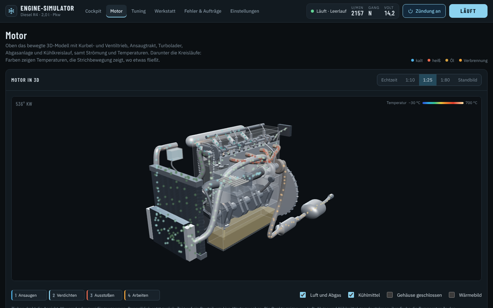
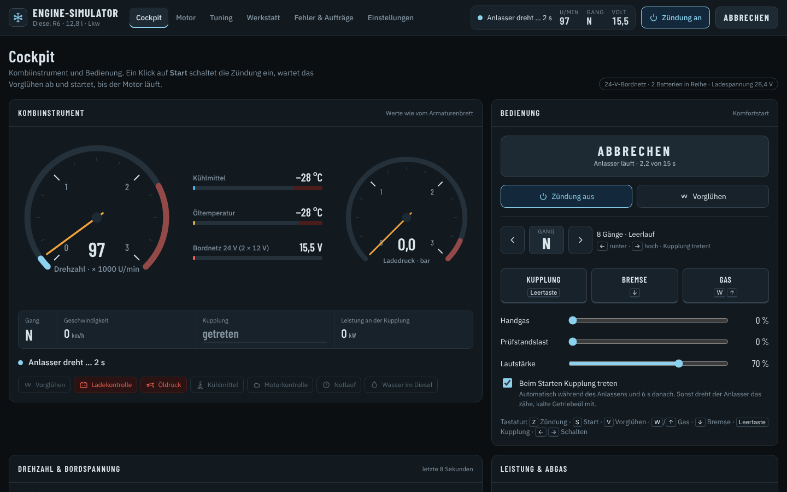
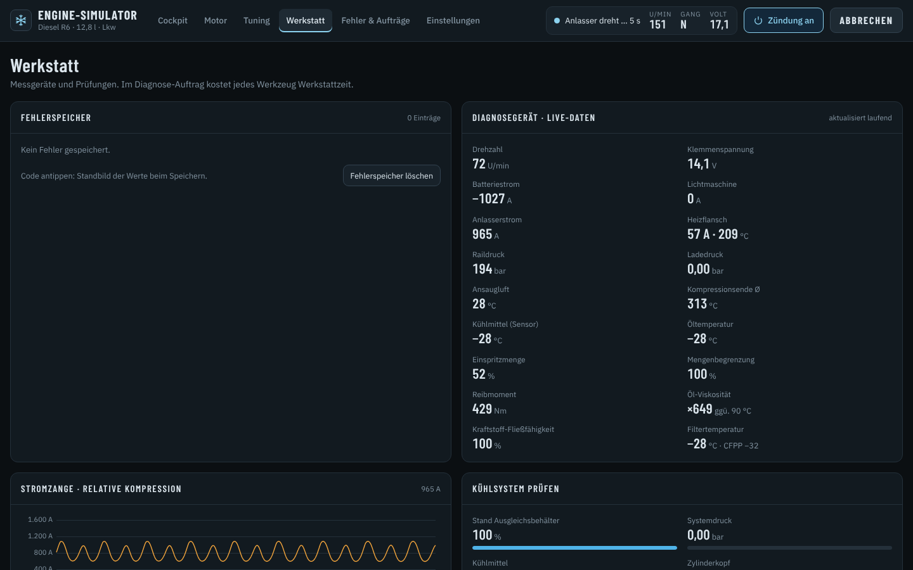
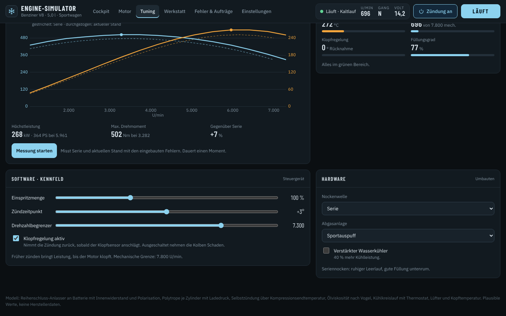
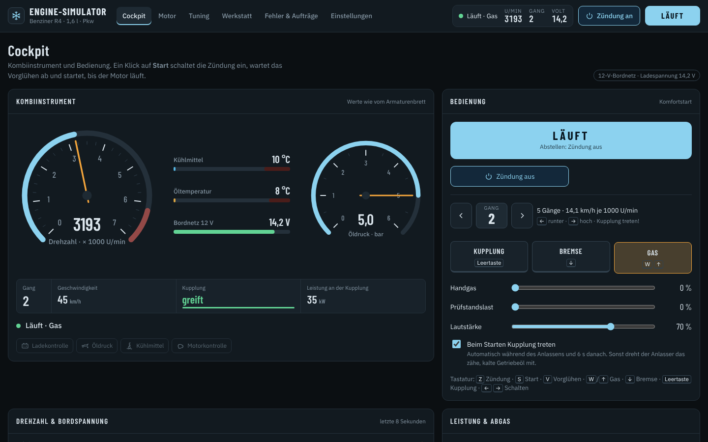
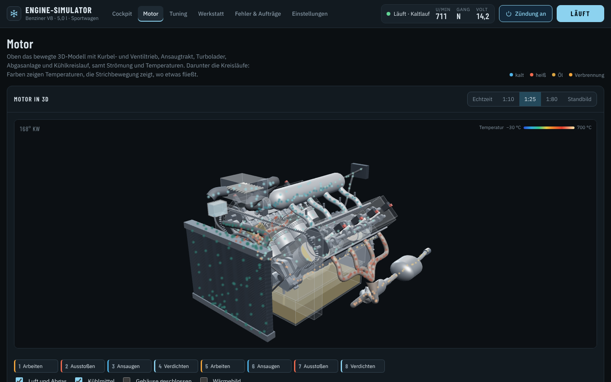
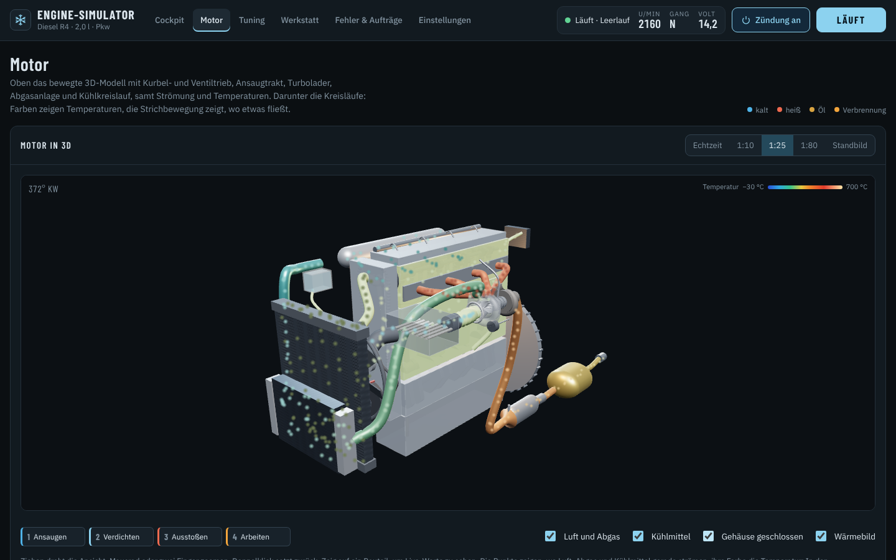
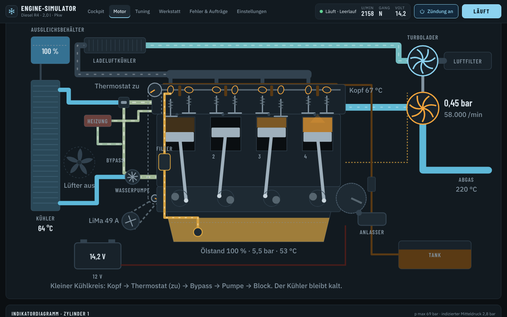

<p align="center">
  
</p>

<h1 align="center">Engine-Simulator</h1>

<p align="center">
  Realistischer Motor-Simulator: Kaltstart bei bis zu −40 °C, Fehlersuche wie in der Werkstatt, Tuning mit Leistungsprüfstand,<br>
  Fahren mit Schaltgetriebe, ein bewegter 3D-Motor mit Strömung und Temperaturen und ein physikalisch modellierter Motorklang.
</p>

<p align="center">
  <a href="https://github.com/Nirodo/Engine-Simulator/releases/latest"></a>
  <a href="https://github.com/Nirodo/Engine-Simulator/actions/workflows/ci.yml"></a>
  
  
  <a href="LICENSE"></a>
</p>

<p align="center">
  
</p>

---

## Inhalt

- [Download und Start](#download-und-start)
- [Was der Simulator kann](#was-der-simulator-kann)
- [Bedienung](#bedienung)
- [Screenshots](#screenshots)
- [Wie realistisch ist das?](#wie-realistisch-ist-das)
- [Selbst bauen](#selbst-bauen)
- [Projektaufbau](#projektaufbau)
- [Lizenz](#lizenz)

## Download und Start

Unter **[Releases](https://github.com/Nirodo/Engine-Simulator/releases/latest)** liegen drei Varianten:

| Datei | Wofür |
|---|---|
| `Engine-Simulator-Setup-<Version>.exe` | Installer für Windows 10/11 (64 Bit) mit Startmenü- und Desktop-Verknüpfung |
| `Engine-Simulator-<Version>-portable.exe` | Ohne Installation, einfach starten |
| `Engine-Simulator-<Version>-web.html` | Läuft in jedem aktuellen Browser (Chrome, Edge, Firefox, Safari), komplett offline |

> **Windows SmartScreen:** Die EXE ist nicht code-signiert. Erscheint beim ersten Start „Der Computer wurde durch Windows geschützt“, über **Weitere Informationen → Trotzdem ausführen** starten.

Der Fortschritt (Motortemperaturen, Batterieladung, Verschleiß, Einstellungen) wird lokal gespeichert. Beim nächsten Start ist der Motor so weit abgekühlt, wie es der vergangenen Zeit entspricht.

## Was der Simulator kann

### Acht Motoren

| Motor | Bauart | Besonderheiten |
|---|---|---|
| Diesel R6 · 12,8 l · Lkw | Reihe, OHC, Turbo | 24-V-Bordnetz mit zwei Batterien, Ansaugluft-Heizflansch, 8-Gang-Getriebe, 16 t |
| Diesel R4 · 2,0 l · Pkw | Reihe, DOHC, Turbo | Glühkerzen, Common-Rail |
| Diesel R6 · 3,0 l · Pkw | Reihe, DOHC, Turbo | großer Pkw-Diesel |
| Benziner R4 · 1,6 l · Pkw | Reihe, DOHC, Saugmotor | Saugrohreinspritzung, Drosselklappe |
| Vergaser R4 · 1,3 l · Oldtimer | Reihe, OHV, Saugmotor | Choke, Beschleunigerpumpe, Zündverteiler, 4 Gänge |
| Benziner V8 · 5,0 l · Sportwagen | V 90°, DOHC | Crossplane-Zündfolge, zwei Abgasstränge |
| Benziner R3 Turbo · 1,0 l | Reihe, DOHC, Turbo | Downsizing-Dreizylinder |
| Boxer 4 · 2,5 l | Boxer, DOHC | ungleich lange Krümmer (typisches Boxer-Brabbeln) |

### Kaltstart

- Außentemperatur von −40 °C bis +40 °C, über Nacht abgekühlter Motor
- Batterie mit Innenwiderstand, Polarisation, Ladezustand, Alterung und Gefrierpunkt
- Reihenschluss-Anlasser, der unter Last einbricht
- Ölviskosität je nach Öl (0W-30 bis 20W-50) und Temperatur
- Selbstzündung des Diesels über die Verdichtungsendtemperatur
- Vorglühen bzw. Heizflansch, Paraffinausscheidung bei Sommerdiesel
- Choke und Absaufen beim Vergaser
- Komfortstart per Klick oder klassisch „Schlüssel halten“



### Fehler und Diagnose

- 30 Fehler aus Elektrik, Kraftstoff, Mechanik, Kühlung und Sensorik, auch je Zylinder: Zündkerze, Injektor, Kompression, gebrochene Kolbenringe.
- Folgeschäden entstehen aus dem Betrieb, zum Beispiel:
  - durchgebrannte Zylinderkopfdichtung (milchiges Öl, weißer Rauch)
  - Ölverlust bis zum Lagerschaden
  - Kühlmittelverlust und Überhitzung
  - Wasserschlag mit verbogenem Pleuel
  - Überdrehzahl mit verbogenem Ventil
  - Klopfschaden und durchgebrannter Kolben
  - Turbolader-Überdrehzahl
- Diagnose-Aufträge mit unbekanntem Fehler: Jedes Messgerät kostet Werkstattzeit, am Ende wird die Diagnose bewertet.
- Fehlercodes mit Standbild der Werte zum Zeitpunkt des Fehlers.



### Werkstatt

Fehlerspeicher, Diagnose-Live-Daten, Stromzange am Anlasser (relative Kompression je Zylinder), Kühlsystem-Prüfung mit CO₂-Tropfentest, Ölprüfung, Batterietest mit Kaltstartstrom und Infrarot-Thermometer am Abgaskrümmer je Zylinder.

### Tuning

- **Software:** Ladedruck, Einspritzmenge, Zündzeitpunkt bzw. Einspritzbeginn, Drehzahlbegrenzer, Klopfregelung.
- **Hardware:** Nockenwellen (Serie, Sport, Rennen), Abgasanlage (Serie, Sport, gerades Rohr), größerer Turbolader, Ladeluftkühler, verstärkter Wasserkühler.
- Der **Leistungsprüfstand** misst die Volllastkurve von Serie und aktuellem Stand.
- Wer übertreibt, bekommt Klopfen, zu heißes Abgas, Turbo-Überdrehzahl und Motorschäden.



### Fahren

Jeder Motor sitzt in einem passenden Fahrzeug mit Masse, Übersetzungen, Luft- und Rollwiderstand.

- **Kupplung:** greift beim Loslassen gestuft, schleift und riecht bei Missbrauch.
- **Schalten ohne Kupplung:** Das Getriebe kracht.
- **Abwürgen:** im zu hohen Gang oder beim Bremsen bis zum Stillstand.
- **Startsperre und Anschieben:** Im Gang springt ein moderner Motor nur mit getretener Kupplung an; rollt das Auto eingekuppelt, lässt er sich anschieben.
- **Überdrehen beim Runterschalten** kann Ventile verbiegen.



### 3D-Motor

- **Kinematik:** Kurbelwelle mit Gegengewichten, Pleuel, Kolben mit Ringen, Nockenwellen mit echtem Nockenprofil, Ventile mit Federn, Steuerkette, Riementrieb, Schwungrad mit Zahnkranz und Anlasser. Alles wird aus Bohrung, Hub, Pleuellänge, Zündfolge und Nockenprofil berechnet.
- **Peripherie:** Ansaugtrakt mit Luftfilter, Drosselklappe und Schwingrohren, Turbolader mit Spiralgehäusen und Schaufelrädern, Ladeluftkühler, Fächerkrümmer, Katalysator, Schalldämpfer, Wasserkühler mit Lüfter, Thermostat, Bypass und Heizungskreis.
- **Strömungsanzeige:** Luft, Abgas und Kühlmittel als Partikel, eingefärbt nach Temperatur. In den Krümmerrohren strömt das Gas nur bei offenem Ventil, durch den Kühler erst bei offenem Thermostat.
- **Wärmebild**, Gehäuse auf/zu, Zeitlupe bis 1:80 und Standbild mit Kurbelwinkel-Regler.
- **Bauteil-Infos:** Zeigen auf ein Bauteil zeigt Live-Werte.
- **Schäden sind sichtbar:** gebrochene Ringe, verbogene Ventile, durchgebrannter Kolben, defekte Kopfdichtung, Wasser im Brennraum.




### Kreisläufe und Indikatordiagramm

- **Schnittbild:** zeigt Kühl-, Öl- und Luftkreislauf, mit kleinem und großem Kühlkreislauf.
- **p-V-Diagramm:** zeigt Zylinder 1 mit indiziertem Mitteldruck.
- **Brennräume:** Jeder Zylinder wird mit Temperatur und Aussetzern angezeigt.



### Motorklang

Der Klang wird nicht aus Aufnahmen abgespielt, sondern berechnet:

- Abgasstöße je Zylinder beim Öffnen des Auslassventils
- Laufzeiten in den Krümmerrohren
- Abgasrohr mit Reflexionen
- Schalldämpfer und Abstrahlung am Endrohr
- Strukturklang des Blocks, beim kalten Diesel deutlich nagelnd
- Ventiltrieb und Injektoren
- Ansauggeräusch
- Turbo-Pfeifen und Abblasen
- Anlasser mit Zahnkranz

Lautstärke einstellbar im Cockpit und in den Einstellungen.

## Bedienung

| Taste | Funktion |
|---|---|
| <kbd>Z</kbd> | Zündung an/aus |
| <kbd>S</kbd> | Start (Komfortstart) bzw. Anlasser halten |
| <kbd>V</kbd> | Vorglühen |
| <kbd>W</kbd> / <kbd>↑</kbd> | Gas (halten) |
| <kbd>↓</kbd> | Bremse (halten) |
| <kbd>Leertaste</kbd> | Kupplung (halten) |
| <kbd>→</kbd> / <kbd>←</kbd> | Gang hoch / runter (aus N nach links: Rückwärtsgang) |
| <kbd>F11</kbd> | Vollbild (Desktop-App) |

**3D-Ansicht:**
- Ziehen dreht die Ansicht.
- Mausrad oder zwei Finger zoomen.
- Doppelklick setzt die Ansicht zurück.

Alle Bedienelemente gibt es auch als Knöpfe, die auf dem Handy bzw. Touchscreen funktionieren.

## Wie realistisch ist das?

Der Simulator rechnet mit physikalischen Modellen statt mit Animationen:

- **Zylinder:**
  - Polytrope je Zylinder mit Leckage, Ladedruck und Kolbenringzustand
  - Selbstzündung über die Verdichtungsendtemperatur
  - Klopfindex beim Benziner
- **Starten:** Anlasser als Reihenschlussmaschine am Batterie-Innenwiderstand, Ölviskosität nach Vogel, Zeitschritt 0,4 ms.
- **Wärme:** Wärmehaushalt für Block, Kopf, Öl, Abgas und Kühlmittel mit Thermostat, Bypass, Lüfter und Heizung.
- **Antrieb:**
  - Turbolader mit Ansprechverhalten, Wastegate und Rauchbegrenzung
  - Kupplung als Reibmoment mit Haft- und Gleitbereich
  - Fahrzeug mit Roll- und Luftwiderstand

Die Werte sind plausibel, aber **keine Herstellerdaten**. Der Simulator ist zum Lernen und Ausprobieren gedacht und ersetzt keine Werkstattanleitung.

## Selbst bauen

Voraussetzungen: [Node.js](https://nodejs.org/) 20 oder neuer.

```bash
git clone https://github.com/Nirodo/Engine-Simulator.git
cd Engine-Simulator
npm install

npm run build   # erzeugt dist/web/Engine-Simulator.html (offline lauffähig)
npm test        # Physik- und Klang-Schnelltest
npm start       # startet die Desktop-App
npm run dist    # baut Installer und portable EXE nach release/ (unter Windows)
```

Ein neues Release entsteht automatisch: Sobald auf `main` eine Version in `package.json` steht, zu der es noch kein Release gibt, baut GitHub Actions auf Windows den Installer, die portable EXE und die Web-Version und legt das Release mit Tag `v<Version>` an (`.github/workflows/release.yml`). Für die nächste Version also `version` in `package.json` erhöhen und `docs/releases/v<Version>.md` anlegen.

## Projektaufbau

```text
src/
  sim.js           Physik-Kern: Batterie, Anlasser, Zylinder, Turbo, Wärme, Fehler, Antriebsstrang
  core.js          Simulations-Schleife im Web Worker, Befehle und Zustandsabzüge
  app.js           Oberfläche: Cockpit, Werkstatt, Fehler, Tuning, Einstellungen, Schnittbild
  engine3d.js      3D-Motor mit three.js, Strömungs- und Wärmebild
  engine_audio.js  Motorklang (Abgas-Wellenleiter, Strukturmoden, Turbo, Anlasser)
  ui.html          Seitengerüst und Gestaltung
desktop/main.js    Electron-Hülle für die Windows-App
tools/build.mjs    baut die Einzeldatei mit eingebetteten Schriften und three.js
tools/selftest.mjs Schnelltest ohne Browser
vendor/            three.js r149 (MIT)
```

## Lizenz

[MIT](LICENSE) © 2026 Nirodo.

Enthält [three.js](https://threejs.org/) (MIT, siehe `vendor/three.LICENSE`) sowie die Schriften Barlow Condensed, IBM Plex Sans und IBM Plex Mono (SIL Open Font License, über [Fontsource](https://fontsource.org/)).
